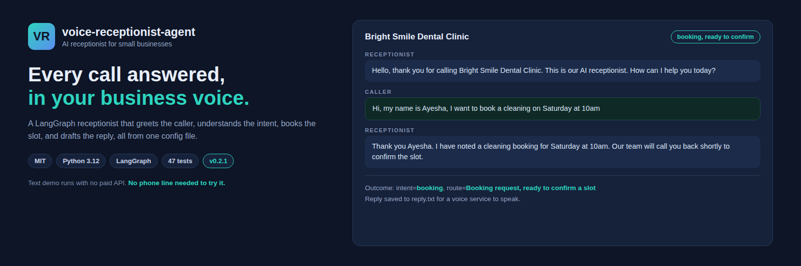
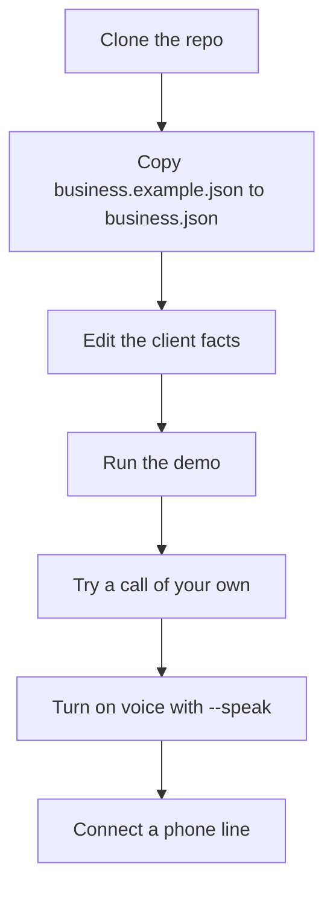
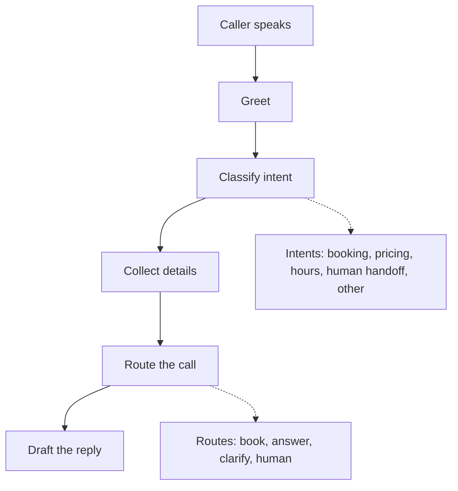
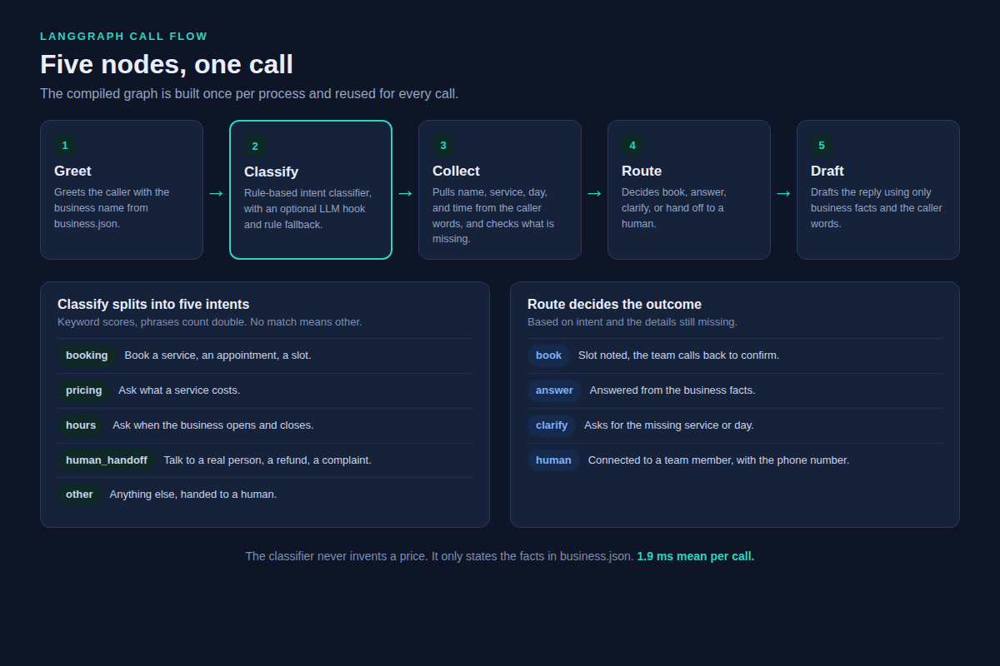
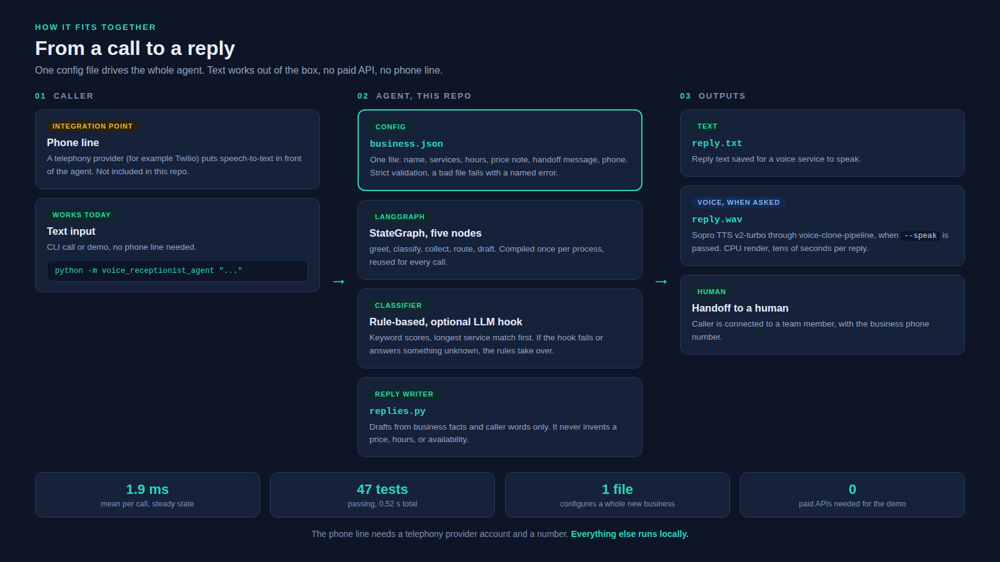

# voice-receptionist-agent

A voice receptionist agent for small businesses. It answers an inbound call, greets the caller, understands the intent, collects the details it needs, routes the call, and drafts a reply in the business's voice.

An agency configures it for a client business by editing one file, `business.json`. No code changes are needed to serve a new business.

It is built on Saif's voice work: the reply text plugs into the [voice-clone-pipeline](https://github.com/saifullah-ai-engineer/voice-clone-pipeline) for speech output in the business's own cloned voice, and the wiring is real, not a stub.



*Designed in HTML and CSS from the real demo call. Not a screenshot.*

## Agency quickstart: a new client in five steps

```bash
git clone https://github.com/saifullah-ai-engineer/voice-receptionist-agent.git
cd voice-receptionist-agent
python3 -m venv .venv
.venv/bin/pip install -r requirements.txt
cp business.example.json business.json
```

1. **Edit `business.json`.** Put in the client name, services, hours, price note, handoff message, and phone number. That is the whole configuration. A bad file fails with a clear error naming the problem, so a typo never silently changes behaviour.
2. **Run the demo for that business.** `PYTHONPATH=src .venv/bin/python examples/demo.py --config business.json` runs three simulated calls with the client facts. No paid API, no phone line, no voice service.
3. **Try a call of your own.** `PYTHONPATH=src .venv/bin/python -m voice_receptionist_agent --config business.json "Hi, I want to book a haircut on Friday at 4pm"` prints the transcript, the intent, and the route, and saves the reply to `reply.txt`.
4. **Turn on voice.** Record 5 to 20 seconds of the business voice, then run the same call with `--speak --voice-ref <voice.wav> --synth-script <path to voice-clone-pipeline scripts/synthesize.sh>`. The reply is rendered as spoken audio in that voice and saved as `reply.wav`. Without `--speak`, the reply stays as text.
5. **Connect a phone line.** Put a telephony provider (for example Twilio) in front of this agent: speech-to-text in, this graph, text-to-speech out. The phone line is an integration step, not included. See "How to connect voice and a phone line" below.



Your own `business.json` is gitignored, so a client config is never committed by accident. Only `business.example.json` is in the repo.

## What it does

- Greets the caller with the business name.
- Understands five intents: booking, price question, opening hours, human handoff, and other.
- Collects the caller's name, the service, and the day and time for bookings. Services are matched against the business config, so a salon books haircuts and a clinic books cleanings.
- Asks a clear follow-up question when a detail is missing, instead of guessing.
- Routes the call: confirm a booking, answer from business facts, or hand off to a human.
- Drafts a reply using only the business facts and the caller's own words.
- Saves the reply text to a file so a voice service can speak it, or renders it as audio with `--speak`.

## 30 second demo

```bash
python3 -m venv .venv
.venv/bin/pip install -r requirements.txt
PYTHONPATH=src .venv/bin/python examples/demo.py
```

You will see three simulated calls: a booking, a price question, and a human handoff, each with its transcript and outcome. No paid API, no phone line, no voice service. Text only.

Try a call of your own:

```bash
PYTHONPATH=src .venv/bin/python -m voice_receptionist_agent "Hi, my name is Ayesha, I want to book a cleaning on Saturday at 10am"
```

Real output from `examples/demo.py --config business.example.json`:

```
Business: Bright Smile Dental Clinic
============================================================
Call 1: booking
============================================================
Receptionist: Hello, thank you for calling Bright Smile Dental Clinic. This is our AI receptionist. How can I help you today?
Caller: Hi, my name is Ayesha, I want to book a cleaning on Saturday at 10am
Receptionist: Thank you Ayesha. I have noted a cleaning booking for Saturday at 10am. Our team will call you back shortly to confirm the slot. Is there anything else I can help with?

Outcome: intent=booking, route=Booking request, ready to confirm a slot
Reply also saved to reply.txt for a voice service to speak.

============================================================
Call 2: price question
============================================================
Receptionist: Hello, thank you for calling Bright Smile Dental Clinic. This is our AI receptionist. How can I help you today?
Caller: Hello, how much does a checkup cost?
Receptionist: Thanks for asking. A checkup is 2,000 PKR and a cleaning is 3,500 PKR. Exact prices depend on the treatment. Would you like to book the checkup?

Outcome: intent=pricing, route=Question answered from business facts
Reply also saved to reply.txt for a voice service to speak.

============================================================
Call 3: human handoff
============================================================
Receptionist: Hello, thank you for calling Bright Smile Dental Clinic. This is our AI receptionist. How can I help you today?
Caller: I need to speak to a real person about a refund, please
Receptionist: Of course. I will connect you with a member of our team about that. You can also reach us at +92 300 0000000.

Outcome: intent=human_handoff, route=Handed off to a human team member
Reply also saved to reply.txt for a voice service to speak.
```

## Configuration

One file, `business.json`. Copy `business.example.json` and edit it. Every field is required.

| Field | What it is |
|---|---|
| `name` | The business name, used in the greeting. |
| `services` | The services the business offers. Only these can be booked. |
| `hours` | Opening hours, stated exactly as written. |
| `price_note` | The price facts the agent may state. It never invents a price. |
| `handoff_message` | What the agent says when it hands off to a human. |
| `phone` | The business phone number, given to callers on handoff. |

Validation rules: the file must be valid JSON, all six fields must be present, `services` must list at least one service with no duplicates, and unknown fields are rejected with an error naming them. A config file can also be passed with `--config`, or a `business.json` in the current directory is picked up automatically.

For a second client, keep a separate config file per client and pass it with `--config`. The code stays the same.

## Call flows

- Booking: greet, classify as booking, collect service and day, confirm the slot, note that the team will call back to confirm.
- Price question: greet, classify as pricing, answer from the business price note, offer to book.
- Opening hours: greet, classify as hours, answer with the business hours, offer to book.
- Human handoff: greet, classify as handoff, connect the caller to a team member and give the business phone number.
- Missing details: greet, classify, ask for the missing service or day, wait for the caller.



## How it works

A real LangGraph `StateGraph` in `src/voice_receptionist_agent/graph.py` runs five nodes: greet, classify, collect, route, draft. The compiled graph is built once per process and reused for every call. The intent classifier is rule-based by default and an optional LLM hook can be passed in; if the hook fails or returns something unknown, the rules take over. Routing lives in `router.py`, reply drafting in `replies.py`, config loading in `config.py`, and voice output in `voice.py`.



*Designed in HTML and CSS from the real graph in graph.py. Not a screenshot.*

## Architecture



*Designed in HTML and CSS from the real code and config. Not a screenshot.*

## How to connect voice and a phone line

**Voice is real and verified.** The `speak` function renders the reply with Sopro TTS v2-turbo through the [voice-clone-pipeline](https://github.com/saifullah-ai-engineer/voice-clone-pipeline) synthesize script, using the business voice reference. It was tested locally: a 7 second reply rendered as 7.2 seconds of audio. Rendering runs on CPU and takes tens of seconds per reply on this machine, so it suits one call at a time, not a call centre queue. Steps:

1. Clone a voice or use the business voice with the [voice-clone-pipeline](https://github.com/saifullah-ai-engineer/voice-clone-pipeline) (Sopro TTS v2-turbo, plus MuseTalk lip-sync if you want video). You need a 5 to 20 second reference recording of the business voice.
2. Run a call with `--speak --voice-ref <voice.wav> --synth-script <synthesize.sh>`, or set `VRA_VOICE_REF` and `VRA_SYNTH_SCRIPT` and pass `--speak`. The reply audio is saved as `reply.wav` next to `reply.txt`.
3. Play the resulting audio on the call.

**The phone line is not included.** For a real phone line, put a telephony provider (for example Twilio) in front of this agent: speech-to-text in, this graph, text-to-speech out. That needs a provider account and a phone number, which this repo does not set up for you.

## Efficiency

Measured locally on this machine, before and after the 0.2.0 upgrade.

| Measure | Before | After |
|---|---|---|
| Call handling, steady state (100 calls) | 4.9 ms mean | 1.9 ms mean |
| Package import time | 0.87 s | 0.04 s |
| Test suite | 20 tests in 0.84 s | 47 tests in 0.52 s |
| Intent classification | 0.004 ms per call | 0.004 ms per call, unchanged |
| Demo run | about 1.05 s | about 1.0 s, unchanged |

What changed: the compiled LangGraph is now built once and reused instead of rebuilt on every call, the langgraph import is deferred until the first call, and the service matcher is compiled once per business and cached. The classifier was already fast and was left alone. The demo time barely moved because it was already dominated by one import, which is now deferred.

## Stress test

Measured locally on this machine with 10,000 real calls, no live service involved.

| Measure | Result |
|---|---|
| Sustained load, 1 thread, 10,000 calls | 1.9 ms mean, 2.3 ms p95, 3.0 ms p99, 526 calls per second, 0 errors |
| Same input at call 1 and call 10,000 | Identical output, 0 mismatches |
| Memory over 10,000 calls | RSS grew 0.3 MB, no leak |
| 4 threads, 10,000 calls | 466 calls per second, slower than 1 thread; threads do not help, the work is CPU-bound Python, use processes instead |
| 4 processes, 10,000 calls | 682 calls per second on a 1.5 CPU machine |
| Business with 100 services | 8.6 ms mean per call, longest match still wins |
| Business with 1,000 services | 10.7 ms mean per call, longest match still wins; a new 1,000-service list costs about 200 ms once to compile the matcher, then it is cached |
| 5,000 character caller message | 10 ms, intent still correct |
| Empty message, whitespace only, empty call | Handled, routes to a human with a polite reply, no crash |
| 20-turn conversation | Transcript grows linearly, 839 characters for 20 turns, no unbounded growth |
| Malformed configs under load | All 9 bad configs fail with a clear named error in about 0.2 ms; the agent keeps answering correctly between them |
| Voice hook with a missing script | Fails loudly in 0.2 ms, 100 calls in 5 ms total, never hangs |

## What changed in 0.2.1

- Fixed a real stress-test finding: a clarify reply listed every service the business offers, so a business with 1,000 services got a 14,060 character reply read aloud. The reply now names the first 8 services and says how many more there are. Small businesses see no change.
- 2 new tests, 47 in total.

## What changed in 0.2.0

- Business config moved out of code into `business.json`, with validation and a documented example. A new business is a config change, not a code change.
- Service extraction now uses the business config, so the agent only books services the business actually offers.
- Voice rendering is wired to the local Sopro TTS synthesize script and verified with a real render. Text-only remains the default.
- The CLI takes `--config`, `--out`, `--speak`, `--voice-ref`, and `--synth-script`, and reads `VRA_VOICE_REF` and `VRA_SYNTH_SCRIPT` from the environment.
- 25 new tests, 45 in total. Issue and PR templates, CONTRIBUTING.md, SECURITY.md, and Dependabot added. CI now also runs the demo with the example config and fails on placeholder text.

## Honest limits

- This is a text demo by default. It does not answer a real phone call until you put a telephony provider in front of it.
- Voice rendering works locally but is slow on CPU, tens of seconds per reply, and needs the voice-clone-pipeline script and a voice reference recording.
- The intent classifier is keyword-based by default. It handles the common phrasings well and asks for clarification when it is unsure, but it is not a full speech understanding system.
- It only knows the facts in the business config. It never invents prices, hours, or availability.
- It does not store call recordings or caller data. Add your own storage if you need call logs.

## Project structure

```
voice-receptionist-agent/
├── .github/
│   ├── ISSUE_TEMPLATE/
│   │   ├── bug_report.md
│   │   └── feature_request.md
│   ├── workflows/
│   │   └── ci.yml
│   ├── dependabot.yml
│   └── pull_request_template.md
├── docs/
│   └── images/
│       ├── hero.png
│       ├── call-flow.png
│       ├── architecture.png
│       └── src/
│           ├── hero.html
│           ├── call-flow.html
│           └── architecture.html
├── examples/
│   └── demo.py
├── src/
│   └── voice_receptionist_agent/
│       ├── __init__.py
│       ├── __main__.py
│       ├── config.py
│       ├── graph.py
│       ├── intents.py
│       ├── models.py
│       ├── replies.py
│       ├── router.py
│       └── voice.py
├── tests/
│   ├── test_agent.py
│   ├── test_config.py
│   └── test_voice.py
├── .gitignore
├── CONTRIBUTING.md
├── LICENSE
├── README.md
├── SECURITY.md
├── business.example.json
├── pyproject.toml
└── requirements.txt
```

The three README visuals are built by hand in HTML and CSS. Their sources live in `docs/images/src/`, and the PNGs are renders of those pages.

## Tests

```bash
PYTHONPATH=src .venv/bin/python -m pytest tests/ -q
```

47 tests cover each intent, the LLM hook and its fallback, name and detail extraction, missing details, routing, full end-to-end calls, a custom business profile, config loading and every validation error, the graph being built once, multi-word services, the voice stub plus the Sopro wiring with a fake script, and the clarify reply cap for long service lists.

## Contributing

See CONTRIBUTING.md. Security issues go to SECURITY.md, not a public issue.

## License

MIT. See LICENSE.
